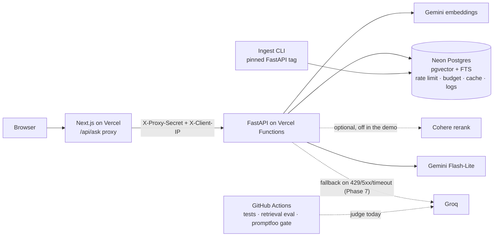
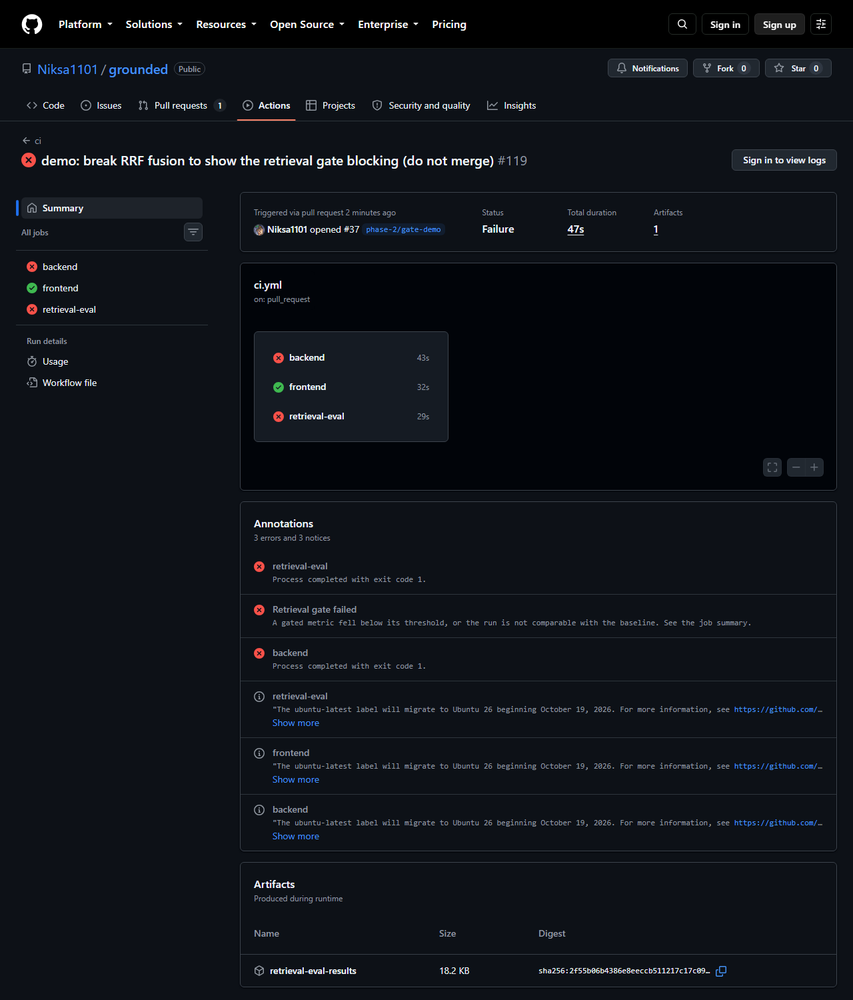
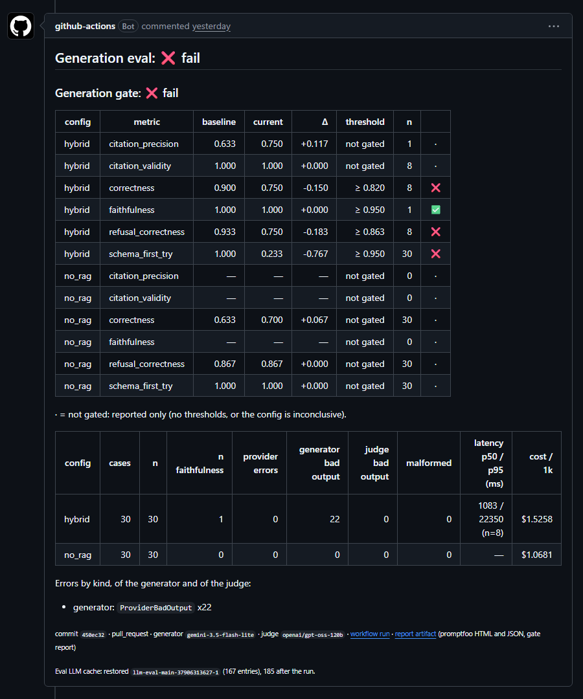

# Grounded

**Cited, schema-validated answers over the FastAPI documentation, with an evaluation harness that blocks quality regressions in CI.**

> ✅ **Status: Phases 0–5 done. The MVP is complete (2026-10-12) and live.**
> Built and merged: the ingestion and the golden set, hybrid retrieval with a CI retrieval gate, `/v1/ask` with structured
> output and citations, the promptfoo generation eval with a judge on another provider, a committed baseline and a CI
> quality gate, and (Phase 5) the input limits, the Postgres rate limiter and daily budget, the proxy secret, the ask page,
> the Vercel deployment, Neon production and the housekeeping workflow ([MVP status](#mvp-status)). Parts of this page
> describe the target system and say so (Phases 6–8). Sections and cells marked _TBD_ are filled in only from committed
> eval results and real measurements, never by hand.

| | |
|---|---|
| Live demo | <https://grounded-alpha.vercel.app> (free tiers: 20 questions a day per visitor, a shared daily budget, and the first question after a quiet period takes a few seconds longer) |
| Metrics dashboard | _TBD (Phase 8)_ |
| Docs | [Product spec (PRD)](docs/PRD.md) · [Technical design](docs/Tech.md) · [Database](docs/DB.md) · [Rules for contributors & agents](AGENTS.md) · [Runbooks](docs/runbooks/) |

---

## The problem

Keyword search on documentation sites misses questions phrased differently from the docs. Generic chatbots
answer from stale training data with no sources. Developers need **short, correct answers with code and a link to
the exact section**, and an honest "the docs don't cover this" when that's the case.

Grounded answers questions about [FastAPI](https://fastapi.tiangolo.com) using retrieval-augmented generation over a
frozen snapshot of the official docs, and it **measures** how well it does that.

## What it does

Built unless marked *planned*:

- **Hybrid retrieval:** pgvector dense search + Postgres full-text search, fused with Reciprocal Rank Fusion. Optional Cohere re-ranking is built behind `RERANK_PROVIDER` (default `none`, and off in the deployed demo: Cohere's trial key may not be used in production). It degrades to the RRF order on any error, timeout or daily cap. Measured on the golden set it lifts nDCG@5 from 0.665 to 0.807 (n = 25) at about 2.5 times the cost per question ([Re-ranking: what it bought](#re-ranking-what-it-bought)).
- **Structured output:** every answer is a Pydantic-validated object. Native JSON-schema generation, validation, one repair retry. If it is still invalid, the provider router falls back to a second provider (Groq); only when every provider fails is it a `502` ([Resilience](#resilience-fallback-and-circuit-breaker-draft)).
- **Verifiable citations:** each claim cites source labels. The server validates them and maps them to exact `docs-page#section` links. The model never writes URLs.
- **Honest refusals:** `answered | partial | insufficient_context`. Out-of-scope questions are refused, and that behavior is measured.
- **Per-claim confidence:** computed server-side from retrieval signals. Whether it is calibrated is *planned* to be measured (Phase 8); today it is a documented heuristic.
- **Evals as a gate:** golden set, retrieval metrics (Recall@k, MRR, nDCG), generation metrics (faithfulness, correctness, refusal accuracy) via promptfoo, and a CI gate that fails a PR on regression.
- **Protection on $0:** a per-client rate limit (5 a minute, 20 a day) and a global daily LLM budget (300 calls), the demo's configured values, whose counters are Postgres rows, an answer cache, input limits, a proxy secret between the two Vercel projects, and request telemetry with shadow cost. The public dashboard (p50/p95 per stage) is *planned* (Phase 8).

## MVP status

Phase 5 ends the MVP, and its four exit criteria ([PRD §9](docs/PRD.md#9-delivery-phases)) were checked one by one on
2026-10-12, and after the Author's rollout the same day **all four pass: the MVP is complete.** The evidence for each row,
the workflow-by-workflow CI table and the manual check of the rate limit and the budget are in
[docs/runbooks/mvp-closeout.md](docs/runbooks/mvp-closeout.md).

| Exit criterion | Status |
|---|---|
| The live URL answers a question after the backend was idle; cold start measured and documented | **Pass.** After 30 minutes idle the first question took 7.04 s end to end; the numbers are in [cost and latency](#cost-and-latency) and the reports in the [Vercel runbook](docs/runbooks/vercel-deploy.md#results) |
| Rate limit and budget verified manually | **Pass.** On the live site: the 6th question of a minute and the 21st of a UTC day get `429` with `Retry-After`; a lowered budget refuses a new question with `503` before any model call, and cached answers are still served |
| README numbers are copied from committed eval results, never typed by hand | **Pass.** The eval and agreement blocks are the output of `grounded eval report` and `grounded eval agreement`, and a test fails if either drifts; every other number in this page was traced to committed output, a decision record or a dated measurement. The live numbers come from the dated measurements of 2026-10-12 |
| All CI workflows green on `main` | **Pass.** All five: `ci` and `eval` on every push, `warm-cache` once by hand (2026-10-02), and `ingest.yml` and `housekeeping.yml`, which the Author ran against production on 2026-10-12 |

## Architecture



Dotted edges are not in the normal request path of the deployed demo: rerank is built but switched off, and Groq answers only when Gemini fails (the fallback is configured in the demo since 2026-10-23); Groq is also the CI eval judge ([Resilience](#resilience-fallback-and-circuit-breaker-draft)).
Request flow: validate → rate-limit → cache lookup → budget check → embed → hybrid retrieve (dense ∪ FTS → RRF) →
(optional rerank →) build context → reserve budget → structured generation → validate/retry → map citations → score confidence → log →
respond. Details and the contracts: [docs/Tech.md §1](docs/Tech.md).

## Evaluation

Golden set: 30 hand-curated questions (25 answerable, 5 deliberately unanswerable) with section-level graded
relevance labels. Retrieval metrics are deterministic. Generation metrics use an LLM judge on a *different* provider
than the generator, and the judge's agreement with human labels is published.

<!-- eval-report:start -->
**Retrieval ablation** (`eval/baselines/retrieval.json`; retrieval only, no LLM): golden set v1 (sha256 8f084817), index 0.141.1@4949e8a3, embedding gemini-embedding-001 (768 dims), git 18fd399 | 456c709, 2026-10-01 | 2026-10-13.

| Config | n | k | Recall@5 | Recall@10 | MRR | nDCG@5 | nDCG@10 |
|---|---:|---:|---:|---:|---:|---:|---:|
| dense | 25 | 20 | 0.760 | 0.920 | 0.714 | 0.698 | 0.752 |
| fts | 25 | 20 | 0.580 | 0.700 | 0.435 | 0.466 | 0.513 |
| hybrid | 25 | 40 | 0.740 | 0.780 | 0.657 | 0.665 | 0.685 |
| hybrid_rerank | 25 | 40 | 0.900 | 0.980 | 0.833 | 0.807 | 0.834 |
| *PRD §8 target (hybrid)* |  |  | ≥ 0.80 | — | ≥ 0.60 | ≥ 0.65 | — |
| *hybrid vs target* |  |  | not met | — | met | met | — |

**Generation baseline** (`eval/baselines/generation.json`): golden set v1 (sha256 8f084817), index 0.141.1@4949e8a3, generator gemini / gemini-3.5-flash-lite (prompts: no_rag answer_no_rag_v1@5f725a9d, hybrid answer_v1@08cc49e5, hybrid_rerank answer_v1@08cc49e5), judge groq / openai/gpt-oss-120b (judge_correctness_v1@1bde5fe4, judge_faithfulness_v1@84103412), promptfoo 0.123.1, git 2a7d381 | 9c0bade, 2026-10-08 | 2026-10-13.

| Metric | no_rag | hybrid | hybrid_rerank | Target (PRD §8) | hybrid vs target |
|---|---:|---:|---:|---:|---:|
| Questions asked | 30 | 30 | 30 |  |  |
| Faithfulness | — | 1.000 (n=23) | 1.000 (n=25) | ≥ 0.90 | met |
| Answer correctness | 0.633 (n=30) | 0.900 (n=30) | 1.000 (n=30) | ≥ 0.75 | met |
| Refusal accuracy | 0.867 (n=30) | 0.933 (n=30) | 1.000 (n=30) | ≥ 0.90 | met |
| Schema first-try validity | 1.000 (n=30) | 1.000 (n=30) | 0.967 (n=30) | ≥ 0.97 | met |
| Citation validity | — | 1.000 (n=30) | 1.000 (n=30) | — | — |
| Citation precision | — | 0.633 (n=23) | 0.727 (n=25) | — | — |
| RAG value: correctness(hybrid) - correctness(no_rag) | — | +0.267 (n=30 vs 30) | — | > 0 | met |
| Latency p50 / p95, ms (warm) | 1769 / 2117 (n=26) | 1901 / 2584 (n=26) | 2101 / 5038 (n=26) |  |  |
| Shadow cost per 1k questions, USD | $1.0064 (n=30) | $1.6855 (n=30) | $4.2144 (n=30) |  |  |

`—`: not applicable or not scored. `n` is the number of questions a metric was scored on (not-applicable and unscored questions are left out). Met / not met compares the unrounded value with the target of PRD §8. `k` is the length of the list a retrieval mode returns (`K_DENSE`, `K_FTS` or `K_FUSED`); MRR runs over it.
<!-- eval-report:end -->

Every number above is pasted from `uv run grounded eval report` (run in `backend/`), which reads only
`eval/baselines/*.json`; a test fails if this block drifts from them, so a baseline PR re-pastes it.
**The generation table is the first baseline (ticket 4.09b):** one full run of the golden set through `no_rag` and
`hybrid`, judged by Groq `openai/gpt-oss-120b`. Faithfulness is claim-level (it grades the claims of an answer, not its
whole text) and is only partly validated by the judge–human agreement below (4.11b). No generation number is written
by hand. The `hybrid_rerank` rows come from the manual runs of 2026-10-13 (ungated: no thresholds, never run in CI);
what they mean is in [Re-ranking: what it bought](#re-ranking-what-it-bought).
Judge–human agreement: [below](#judge-human-agreement). Golden set: `v1`, 25 answerable questions (retrieval n = 25, one
question = 0.04) and 5 unanswerable ones. Shadow cost is real token counts × paid list prices (dated in
`backend/pricing.toml`); the demo itself runs on free tiers.

### Judge-human agreement

The judge (Groq `openai/gpt-oss-120b`, rubrics `judge_faithfulness_v1@84103412` and `judge_correctness_v1@1bde5fe4`) was
compared with the Author's hand labels on 20 items drawn with a fixed seed from the baseline run above: 10 faithfulness
claims (6 real, 4 synthetic negative controls) and 10 correctness grades (real answers of both configs). The labels were
made on a sheet that shows the evidence and no verdict. How the items were drawn, the procedure and the limits:
[eval/judge_agreement/](eval/judge_agreement/README.md). The labels, the judge's key and the output below are
committed; `uv run grounded eval agreement --labels ../eval/judge_agreement/v1.csv --key ../eval/judge_agreement/v1.key.json`
(in `backend/`) reproduces the output, and a test fails if this block drifts from it. The numbers below are copied from
that output; the sentences around them are the reading.

- **All 20 items: exact agreement 85.0% (17/20), Cohen's kappa 0.808, so the PRD §8 target (0.8) is met by both
  measures.** That is the most flattering view: it pools the labels of two kinds of item and includes the 4 controls,
  which are easy.
- **Faithfulness: 100.0% (10/10), kappa 1.000.** On the 6 real claims the judge and the Author both said `SUPPORTED`;
  on the 4 controls both said `NOT_SUPPORTED`. For the real claims alone kappa is undefined (one label on both sides).
- **Correctness: 70.0% (7/10), kappa 0.538. This is the weak spot, and the target is not met there.** Three grades
  differ (a07, a09, a16); each is one step apart on the three-grade scale, none is `CORRECT` against `INCORRECT`, and the
  judge is stricter than the Author in two and more lenient in one. The kappa is unweighted, so a one-step miss counts like
  a two-step one.
- **Real items only (16): 81.2% (13/16), kappa 0.741, which is below 0.8.** Without the controls the target is met by
  exact agreement and not by kappa. PRD §8 does not say which of the two the 0.8 applies to.
- **Limits.** n = 20, so one item is 5 percentage points. One rater, who also wrote the rubrics. The sample is stratified
  by the judge's own verdict, not random, so this is agreement on this sample and not the judge's accuracy on the run. The
  controls are synthetic: a real claim shown with the sources of another question.

**What it means for the table above.** The judge is not a rubber stamp: it said `NOT_SUPPORTED` for all 4 controls, and the
Author agreed with it on the 6 real claims, which makes the faithfulness **1.000** a little more credible. It does not
validate it. The judge said `SUPPORTED` for all 53 real claims of the run, so the 6 real items can only show agreement on
supported claims; whether the judge catches a *subtly* unsupported real claim (a detail the source does not state) is not
measured at all. Treat 1.000 as "the judge found no unsupported claim", not as a verified zero hallucination rate. The
correctness figures rest on a judge that agrees with the Author on 7 of 10 grades, so a difference between configs of less
than a grade step per question is not a claim. The disagreements, item by item, are in
[eval/judge_agreement/README.md](eval/judge_agreement/README.md#result).

<details>
<summary>The full output of <code>grounded eval agreement</code> (n = 20)</summary>

<!-- agreement-report:start -->
# Judge-human agreement

Sample: seed 411, 20 items from the run 20261008T155539Z-generation.json (sha256 4d571ae1a34b, golden set v1). Judge: groq openai/gpt-oss-120b, rubrics judge_correctness_v1@1bde5fe4, judge_faithfulness_v1@84103412.

| Scope | n | Exact agreement | Cohen's kappa |
|---|---:|---:|---:|
| All items (labels of both kinds pooled) | 20 | 85.0% (17/20) | 0.808 |
| Faithfulness | 10 | 100.0% (10/10) | 1.000 |
| Correctness | 10 | 70.0% (7/10) | 0.538 |
| Real items only (pooled) | 16 | 81.2% (13/16) | 0.741 |
| Faithfulness, real items only | 6 | 100.0% (6/6) | undefined |
| Controls only (synthetic) | 4 | 100.0% (4/4) | undefined |

Kappa of 'Faithfulness, real items only' is undefined: both raters gave every item the label SUPPORTED, so agreement by chance is 100%.
Kappa of 'Controls only (synthetic)' is undefined: both raters gave every item the label NOT_SUPPORTED, so agreement by chance is 100%.

## PRD §8 target

PRD §8 asks for agreement on at least 10 verdicts, 0.8 desired. It does not say whether that is the exact agreement or kappa, so both are shown against it.

| Measure | Value | n | >= 0.8 |
|---|---:|---:|---|
| Exact agreement, all items | 0.850 | 20 | met |
| Cohen's kappa, all items | 0.808 | 20 | met |
| Exact agreement, real items only | 0.812 | 16 | met |
| Cohen's kappa, real items only | 0.741 | 16 | not met |

At least 10 items labeled: yes (n = 20).

## Confusion matrices (rows: human, columns: judge)

### Faithfulness (n = 10)

| human \ judge | SUPPORTED | NOT_SUPPORTED | total |
|---|---:|---:|---:|
| SUPPORTED | 6 | 0 | 6 |
| NOT_SUPPORTED | 0 | 4 | 4 |
| total | 6 | 4 | 10 |

### Correctness (n = 10)

| human \ judge | CORRECT | PARTIALLY_CORRECT | INCORRECT | total |
|---|---:|---:|---:|---:|
| CORRECT | 4 | 1 | 0 | 5 |
| PARTIALLY_CORRECT | 0 | 1 | 1 | 2 |
| INCORRECT | 0 | 1 | 2 | 3 |
| total | 4 | 3 | 3 | 10 |

### Faithfulness, real items only (n = 6)

| human \ judge | SUPPORTED | NOT_SUPPORTED | total |
|---|---:|---:|---:|
| SUPPORTED | 6 | 0 | 6 |
| NOT_SUPPORTED | 0 | 0 | 0 |
| total | 6 | 0 | 6 |

## Disagreements (n = 3 of 20)

- a07 (correctness, real): human INCORRECT, judge PARTIALLY_CORRECT
- a09 (correctness, real): human PARTIALLY_CORRECT, judge INCORRECT
- a16 (correctness, real): human CORRECT, judge PARTIALLY_CORRECT
<!-- agreement-report:end -->

</details>

### Retrieval ablation: reading

**Reading: hybrid did not beat dense here.** That misses the Phase 2 target (hybrid ≥ dense on Recall@5 and MRR).
Per-question evidence from the results file of that run (2026-10-01; the file is gitignored, so these counts are a dated
reading and not a committed number):

- **Recall@5 (−0.02) is within noise**: it moves with one question (q017 and q026 lose it, q019 gains it), and one
  question is worth 0.04.
- **MRR (−0.06) is not clearly noise.** Hybrid ranks the first grade-2 section better on 4 questions and worse on 9.
  Four questions that dense answers at rank 1 drop to rank 2 to 4 (q001, q002, q028, q039).
- **Recall@10 (−0.14) is the largest loss, 4 questions** (q015, q016, q026, q043): dense had a labelled section at
  rank 3 to 10, FTS did not retrieve it, and in the fused list it falls to rank 11 to 20.
- **FTS alone is the weak side** (the lowest Recall@5 and MRR in the table). Its OR query with `ts_rank_cd` is not BM25. For q016 and
  q026 none of the labelled sections is in its top 20. RRF gives both lists the same weight, so a chunk that both
  lists put at a middle rank outranks one that only dense puts first. This is what the rows are consistent with; no
  experiment here isolates it.

Nothing was tuned to improve these numbers: `K_*` and `RRF_K` are the defaults and the lexical query is unchanged.
n = 25, so differences under one question (0.04) are not claims either way.

### Re-ranking: what it bought

> **The reading below was written by the agent at the Author's request (2026-10-14) and reviewed by the Author in the
> baseline PR.** Every number in it is copied from the eval report above or from `grounded eval diff`, never typed.

**Lift: measured, and it is large on retrieval.** On the 25 answerable golden questions and the same 40 fused candidates,
re-ranking with `rerank-v4.0-pro` raises nDCG@5 from 0.665 to 0.807 (+0.142, n = 25), MRR from 0.657 to 0.833 (+0.176),
Recall@5 from 0.740 to 0.900 and Recall@10 from 0.780 to 0.980. Every one of these deltas is more than three questions'
worth (one question is 0.04 of a mean). It wins on 13 questions, loses on 3 and ties on 9 (by nDCG@5). On answers the
gain is smaller and rests on one run per config, so it is reported as consistent with the retrieval lift, not as proven.
The cost is high: at list price the rerank call alone costs more than the rest of a request.

- **What was built** ([Tech §8](docs/Tech.md), PRD D55). A Cohere reranker (`rerank-v4.0-pro`, pinned) behind
  `RERANK_PROVIDER` (default `none`) reorders the 40 fused candidates (`K_FUSED`); the top 5 (`K_CONTEXT`) become the context.
  `hybrid_rerank` is a config of the retrieval eval and of the promptfoo generation eval, run by hand only. Cohere's Trial
  key accepts `rerank-v4.0-pro` (the first real call, 2026-10-13), so the fallback `rerank-v4.0-fast` was not needed.
- **Where it is switched off.** The deployed demo keeps `RERANK_PROVIDER=none`: Cohere's Trial key may not be used in
  production, so the live site never reranks. CI never runs `hybrid_rerank` either (it would spend the Trial's monthly
  calls), and its baseline rows carry no thresholds, so no gate depends on a Cohere key.
- **How the lift was measured.** On the same 25 answerable questions and the same 40 candidates, the only difference being
  their order: `nDCG@5(hybrid_rerank) - nDCG@5(hybrid)`, the PRD §8 target ("> 0, reported whatever it is"), with MRR,
  Recall@5/10 and nDCG@10 beside it, always with `n`. One question is 0.04 of a mean, so a smaller difference is not reported as a
  lift or a loss. `grounded eval diff` adds the per-question wins and losses and the rank of every labelled section before and
  after. The `hybrid` row of that run reproduced the committed `hybrid` baseline exactly, so the two rows are comparable.
- **Graceful degradation.** Any Cohere error, a 429, a timeout (`RERANK_TIMEOUT_S`, 3 s, one attempt, no retry) or the daily cap
  (`RERANK_DAILY_CAP`, 30) leaves the request on the RRF order: it still succeeds, the reason goes to
  `request_logs.rerank_error` and the log (never to the API response), and an answer built on the degraded order is not stored
  in the answer cache. This is tested with fakes against a real Postgres
  (`backend/tests/integration/test_rerank_path.py` and `test_rerank_cap.py`); the ask page does not show the degradation yet
  (its debug row has "Rerank used"; PRD §12). The confidence number ignores the rerank score (`CONFIDENCE_W_RERANK` = 0.0).
  No case of either real run degraded.
- **What it costs, from committed data only.** At list price (`backend/pricing.toml`: `rerank-v4.0-pro`, $2.50 per 1,000
  searches, read on cohere.com/pricing on 2026-10-12) one reranked request is one search (40 candidates are one search unit),
  so $2.50 per 1,000 requests. The shadow cost per 1,000 questions goes from $1.6855 (`hybrid`) to $4.2144 (`hybrid_rerank`),
  both n = 30. The live rerank calls of the comparison run took p50 578 / p95 906 ms (n = 24 live calls, 2026-10-13); that is
  the call alone, without the eval's pacing. Trial calls are free and capped (1,000 a month, 10 a minute).

**The numbers.** The `hybrid` and `hybrid_rerank` rows of the two tables above, quoted from the eval report:

| Retrieval (n = 25, k = 40) | Recall@5 | Recall@10 | MRR | nDCG@5 | nDCG@10 |
|---|---:|---:|---:|---:|---:|
| hybrid | 0.740 | 0.780 | 0.657 | 0.665 | 0.685 |
| hybrid_rerank | 0.900 | 0.980 | 0.833 | 0.807 | 0.834 |

| Generation (30 questions) | hybrid | hybrid_rerank |
|---|---:|---:|
| Faithfulness | 1.000 (n=23) | 1.000 (n=25) |
| Answer correctness | 0.900 (n=30) | 1.000 (n=30) |
| Refusal accuracy | 0.933 (n=30) | 1.000 (n=30) |
| Schema first-try validity | 1.000 (n=30) | 0.967 (n=30) |
| Citation validity | 1.000 (n=30) | 1.000 (n=30) |
| Citation precision | 0.633 (n=23) | 0.727 (n=25) |
| Latency p50 / p95, ms (warm) | 1901 / 2584 (n=26) | 2101 / 5038 (n=26) |
| Shadow cost per 1k questions, USD | $1.6855 (n=30) | $4.2144 (n=30) |

<details>
<summary>The output of <code>uv run grounded eval diff --config hybrid --config hybrid_rerank --results ../eval/results/rerank-compare-first.json</code> (in <code>backend/</code>; its headings turned into bold lines)</summary>

**`hybrid_rerank` against `hybrid`**

Paired over the same 25 answerable questions (5 unanswerable ones are not scored), from one results file: golden set v1 (sha256 8f084817), index 0.141.1@4949e8a3, embedding gemini-embedding-001 (768 dims), k = 40, git 9c0bade. Every delta is `hybrid_rerank` minus `hybrid`, computed from the unrounded numbers of the results file.

**Mean metrics**

| Metric | n | hybrid | hybrid_rerank | Delta |
|---|---:|---:|---:|---:|
| Recall@5 | 25 | 0.740 | 0.900 | +0.160 |
| Recall@10 | 25 | 0.780 | 0.980 | +0.200 |
| MRR | 25 | 0.657 | 0.833 | +0.176 |
| nDCG@5 | 25 | 0.665 | 0.807 | +0.142 |
| nDCG@10 | 25 | 0.685 | 0.834 | +0.149 |

**Per-question outcome by nDCG@5**

`hybrid_rerank` is better on 13 questions, `hybrid` is better on 3, and they tie on 9 (n = 25). A tie is a difference of at most 1e-9 in nDCG@5 (float noise); any other difference is a win or a loss, however small.

**One question's worth.** With n = 25, one question moves a mean metric by at most 1/25 = 0.040 (a per-question metric lies in [0, 1]). A difference of means below that is not reported as a lift or a loss (AGENTS.md §7). This is a paired comparison on 25 questions, not a significance test. The nDCG@5 delta, +0.142, is at least one question's worth.

**Rerank calls**

`hybrid_rerank` reranked with rerank-v4.0-pro: 24 live calls, 1 answered from the rerank cache; live latency p50 578 / p95 906 ms.

**Per question**

Sorted by the nDCG@5 delta (losses first), then by question id. A rank is the 1-based position of the first chunk that matches the label; `null` means the label was not retrieved. Labels are listed in the golden set's order.

| Question | Type | Δ Recall@5 | Δ Recall@10 | Δ MRR | Δ nDCG@5 | Δ nDCG@10 | Grade-2 label ranks, hybrid -> hybrid_rerank |
|---|---|---:|---:|---:|---:|---:|---|
| q003 | factual | 0.000 | 0.000 | -0.500 | -0.369 | -0.369 | `tutorial/index.md#install-fastapi`: 1 -> 2 |
| q030 | code | 0.000 | 0.000 | 0.000 | -0.107 | -0.107 | `tutorial/request-files.md#multiple-file-uploads`: 1 -> 1 |
| q019 | how_to | 0.000 | 0.000 | 0.000 | -0.012 | -0.012 | `tutorial/request-forms.md#define-form-parameters`: 3 -> 3 |
| q007 | factual | 0.000 | 0.000 | 0.000 | 0.000 | 0.000 | `advanced/custom-response.md#streamingresponse`: 1 -> 1 |
| q011 | factual | 0.000 | 0.000 | 0.000 | 0.000 | 0.000 | `tutorial/cookie-params.md#declare-cookie-parameters`: 1 -> 1 |
| q013 | factual | 0.000 | 0.000 | 0.000 | 0.000 | 0.000 | `tutorial/dependencies/dependencies-with-yield.md#scope-for-sub-dependencies`: 1 -> 1 |
| q020 | how_to | 0.000 | 0.000 | 0.000 | 0.000 | 0.000 | `tutorial/handling-errors.md#override-the-httpexception-error-handler`: 1 -> 1 |
| q022 | how_to | 0.000 | 0.000 | 0.000 | 0.000 | 0.000 | `advanced/security/http-basic-auth.md#check-the-username`: 1 -> 1 |
| q023 | how_to | 0.000 | 0.000 | 0.000 | 0.000 | 0.000 | `deployment/concepts.md#previous-steps-before-starting`: 1 -> 1 |
| q029 | code | 0.000 | 0.000 | 0.000 | 0.000 | 0.000 | `tutorial/query-params-str-validations.md#query-parameter-list-multiple-values-with-defaults`: 1 -> 1 |
| q034 | code | 0.000 | 0.000 | 0.000 | 0.000 | 0.000 | `tutorial/handling-errors.md#install-custom-exception-handlers`: 1 -> 1 |
| q042 | multi_section | 0.000 | 0.000 | 0.000 | 0.000 | 0.000 | `advanced/response-cookies.md#use-a-response-parameter`: 1 -> 1; `advanced/response-headers.md#use-a-response-parameter`: 2 -> 2 |
| q018 | how_to | 0.000 | +0.500 | 0.000 | +0.024 | +0.192 | `advanced/behind-a-proxy.md#redirects-with-https`: 1 -> 1; `advanced/behind-a-proxy.md#enable-proxy-forwarded-headers`: 31 -> 9 |
| q036 | multi_section | 0.000 | 0.000 | +0.500 | +0.088 | +0.088 | `tutorial/body-updates.md#using-pydantics-exclude-unset-parameter`: 2 -> 1; `tutorial/body-updates.md#using-pydantics-update-parameter`: 4 -> 5 |
| q008 | factual | 0.000 | +1.000 | +0.127 | +0.102 | +0.396 | `tutorial/response-model.md#fastapi-data-filtering`: 25 -> 6 |
| q031 | code | 0.000 | 0.000 | 0.000 | +0.174 | +0.076 | `advanced/stream-data.md#stream-bytes`: 1 -> 1 |
| q028 | code | 0.000 | 0.000 | +0.500 | +0.203 | +0.203 | `tutorial/body-nested-models.md#deeply-nested-models`: 2 -> 1 |
| q039 | multi_section | 0.000 | +0.500 | +0.500 | +0.213 | +0.362 | `tutorial/security/simple-oauth2.md#use-the-form-data`: 22 -> 10; `tutorial/security/simple-oauth2.md#return-the-token`: 2 -> 1 |
| q043 | multi_section | 0.000 | 0.000 | +0.500 | +0.322 | +0.260 | `tutorial/handling-errors.md#add-custom-headers`: 19 -> 16; `tutorial/security/simple-oauth2.md#update-the-dependencies`: 2 -> 1 |
| q017 | how_to | +1.000 | 0.000 | +0.233 | +0.358 | +0.119 | `tutorial/first-steps.md#configure-the-app-entrypoint-in-pyproject-toml`: 10 -> 3 |
| q002 | factual | 0.000 | 0.000 | +0.500 | +0.424 | +0.325 | `advanced/using-request-directly.md#details-about-the-request-object`: 2 -> 1 |
| q001 | factual | 0.000 | 0.000 | +0.750 | +0.470 | +0.470 | `advanced/custom-response.md#json-responses`: 4 -> 1 |
| q015 | factual | +1.000 | +1.000 | +0.450 | +0.509 | +0.509 | `tutorial/security/simple-oauth2.md#use-the-form-data`: 20 -> 2 |
| q016 | how_to | +1.000 | +1.000 | +0.429 | +0.566 | +0.628 | `advanced/advanced-dependencies.md#a-callable-instance`: 15 -> 2; `advanced/advanced-dependencies.md#use-the-instance-as-a-dependency`: 14 -> 5 |
| q026 | how_to | +1.000 | +1.000 | +0.409 | +0.591 | +0.591 | `tutorial/background-tasks.md#using-backgroundtasks`: 15 -> 4; `tutorial/background-tasks.md#add-the-background-task`: 11 -> 2 |

</details>

**Reading.**

- **Retrieval: a real lift, from rescuing sections the fusion buried.** The biggest wins are questions whose grade-2 section
  sat deep in the fused list and moved into the top 5: q015 (rank 20 to 2), q016 (15 to 2), q026 (11 and 15 to 2 and 4),
  q017 (10 to 3), and q008 (25 to 6, into the top 10). That is what a cross-encoder does well and the RRF of two first-stage
  rankings cannot: it reads the question and the chunk together. Nine questions tie because the label was already first.
- **The losses are small, and the largest may be a label gap.** q030 (-0.107) and q019 (-0.012) lose less than one question's
  worth. q003 loses 0.369: its label `tutorial/index.md#install-fastapi` drops from rank 1 to 2, because the reranker puts the
  section `#without-fastapi-cloud-cli` first. The question asks how to install FastAPI "without the FastAPI Cloud CLI", and
  that section holds the exact command; the generated answer gives that command and the judge grades it correct. The golden
  labels of q003 probably miss that section. They are not changed here (`v1` is referenced by the baselines); it is a
  candidate for `v2`.
- **Answers: better, on a smaller and noisier signal.** Correctness goes from 0.900 to 1.000 and refusal accuracy from 0.933 to
  1.000 (n = 30 each, three and two questions' worth), faithfulness stays 1.000 while two more answerable questions are
  answered instead of refused (n = 23 to 25), and citation precision rises from 0.633 to 0.727. These come from one run of each
  config, five days apart, with the same generator, prompt and judge; an LLM run is not deterministic, so they agree with the
  retrieval lift but do not prove it on their own. Schema first-try validity drops from 1.000 to 0.967: one case needed its
  one retry. That is one question's worth, the prompt and the schema are the same, and it is not attributed to re-ranking.
- **Latency: the call costs about half a second.** The live calls took p50 578 / p95 906 ms. The generation table's latency
  (p95 2584 to 5038 ms) is not a measure of the rerank: in that run all but 4 reranks came from the rerank cache, so the
  difference is mostly Gemini's own variance on another day.
- **Cost and recommendation.** Re-ranking makes a request about 2.5 times as expensive at list price ($1.6855 to $4.2144 per
  1,000 questions), almost all of it the Cohere search. The quality gain is large enough to be worth that where the answer is
  the product, and the measurement supports turning it on. It stays off in the deployed demo for now: the Trial key may not be
  used in production (D55), and a production key means real cost, so switching the demo on is a separate decision for the
  Author, not part of Phase 6. Two follow-ups are noted in PRD §12: the q003 label for golden set `v2`, and whether the rerank
  score should get a weight in the confidence heuristic once calibration is measured (Phase 8).

### CI quality gate
- **Every PR:** lint, types, unit + integration tests, retrieval eval vs baseline (the `retrieval-eval` job: a fresh
  pgvector service, the pinned corpus ingested from cached embeddings, dense/fts/hybrid scored on the golden set, and
  `grounded eval gate` blocking a drop of more than one question's worth on hybrid Recall@5, MRR or nDCG@5). The
  metrics table is in the job summary. A cold embedding cache with no key or quota is reported as an **infrastructure
  failure** (exit code 3), never as a quality result; `warm-cache.yml` seeds the cache.
- **PRs labeled `run-eval`, every push to `main`, and manual runs:** the full promptfoo generation eval (`eval.yml`: the 30
  golden questions through `no_rag` and `hybrid` at concurrency 1, the generator on Gemini and the judge on Groq with
  both model IDs pinned in the workflow, then `grounded eval gate --suite generation` against
  `eval/baselines/generation.json`). On a PR the job `eval` runs whenever the PR carries the label (adding it, a later
  push, reopening and adding any other label all re-run it) and is skipped otherwise, so a PR that can change answer
  quality (prompts, retrieval, chunking, context, schemas, model IDs) must carry the label (AGENTS.md §7): nothing else
  tells the workflow that a PR is quality-affecting. The numbers it is compared with are the generation block of
  [the report above](#evaluation), which `grounded eval report` prints from the baseline file.
- **Three outcomes**, decided by the gate and by nothing else (promptfoo exits 100 whenever any single assertion fails,
  also in a run that passes, so its exit code is ignored):

  | Outcome | Means | Job |
  |---|---|---|
  | ✅ **pass** | every gated `hybrid` metric (faithfulness, answer correctness, refusal accuracy, schema first-try validity) is at or above its threshold: the baseline minus a tolerance, or a floor | green |
  | ❌ **fail** | a gated metric is below its threshold, or the run cannot be compared with the baseline (another golden set or index, or a gated metric no question could score) | red, with an error annotation |
  | ⚠️ **inconclusive** | more than 20% of a config's cases ended in a provider error (a quota, a 5xx or a timeout, of the generator or of the judge), so nothing of that config is gated and its metrics are shown with `n` | green, with a warning annotation. **Not a pass: re-run once the quota has reset or the provider has recovered** |

  A run that could not even start (the setup failed, promptfoo crashed, the gate had no results to read) is red too and
  says "the eval did not run"; it is never shown as a pass.
- **Reading the PR comment.** One comment, found by a hidden marker and edited on every push, never duplicated. It opens
  with the verdict, then the gate table (config, metric, baseline, current, Δ, threshold, `n`, ✅/❌; `·` means reported
  only), then one line per config (cases, `n`, `n` for faithfulness, provider errors, bad outputs, latency, cost per 1k
  questions), the errors by kind, and a footer with the commit, the models and links to the run and to the downloadable
  report (promptfoo HTML and JSON, the gate's Markdown, the log). `n` is per metric: a question a metric does not apply
  to (faithfulness of a refusal) is left out of it, and a question the judge could not grade is left out too.
- **Free-tier constraints are part of the design.** The judge runs on Groq's free plan (a daily token quota, and 8K tokens
  a minute), the generator on Gemini's, and a full run uses most of the day's Groq quota ([PRD §12](docs/PRD.md#12-assumptions-and-open-items)).
  A cache of LLM replies keeps what was paid for, so an identical re-run is free, and a run that hits a quota stops
  asking and ends `inconclusive`. The first CI runs mostly ended that way (a quota already spent, and spells of
  Gemini 503s): of the 21 runs on `main` that finished green by 2026-10-12, the 6 of 2026-10-08 were `inconclusive` and
  the 15 since 2026-10-09 gated and passed (verdicts read from the run logs; no run on `main` failed). Every push to
  `main` starts a real eval, so merges spend quota too.
- **What a red `eval` check does.** Since PR [#88](https://github.com/Niksa1101/grounded/pull/88) (2026-10-10) `eval` is
  reported on every PR, and it is a required status check of `main` next to `backend`, `frontend` and `retrieval-eval`
  (branch protection is a repository setting, not a file in the repository). A job skipped for want of the label counts
  as a success, so only a labeled PR whose gate fails, or whose eval could not run, cannot be merged; the demo PR below
  shows `BLOCKED`. `inconclusive` succeeds with a warning and is not a pass. **The label is still the weak point:** a PR
  without it is not evaluated, and removing the label from a red PR clears the block on the next push (that run is then
  skipped). So the protection rests on the label being added to every quality-affecting PR (AGENTS.md §7) and on the
  review. The gate also sees format and schema regressions better than wording ones: see
  [limitations](#failure-modes-and-limitations).
- A run on `main` is also recorded in the `eval_runs` table for the dashboard (aggregates only). That write is shipped
  **disabled** until the repository variable `EVAL_RECORD_RUNS` is set to `true`.

**Retrieval gate demonstration.** A deliberately broken fusion (the dense term dropped from the RRF score) blocked by the
retrieval gate ([run](https://github.com/Niksa1101/grounded/actions/runs/37453667731), closed PR
[#37](https://github.com/Niksa1101/grounded/pull/37)): hybrid Recall@5 0.74 → 0.58, MRR 0.66 → 0.44, nDCG@5 0.66 → 0.47,
n = 25.



**Generation gate demonstration.** A deliberately degraded `answer_v1`: one line of the prompt changed so that its
`citation_ids` example (`["[c1]", "[c3]"]`) contradicts the schema (`^c[1-9]$`). The generation gate failed it
([run](https://github.com/Niksa1101/grounded/actions/runs/38044085266), closed unmerged PR
[#86](https://github.com/Niksa1101/grounded/pull/86), the
[comment](https://github.com/Niksa1101/grounded/pull/86#issuecomment-6096484617) with the gate table): schema first-try
validity, answer correctness and refusal accuracy of `hybrid` fell below their thresholds, and most generator calls
were bad output after their one retry, with no provider error, so the verdict is a fail and not inconclusive. Weakening
the *instructions* instead (six local attempts) moved no gated metric on this model, which is why the demonstration is a
format mismatch ([PRD §12](docs/PRD.md#12-assumptions-and-open-items)). When it ran, `eval` was not yet a required check
and GitHub showed the PR as mergeable; making it required (#88) turned the same PR into `BLOCKED`. The inconclusive
outcome was seen in real CI runs, and the report of all three outcomes is pinned by committed fixture tests.



*A crop of the CI bot's comment on the demo PR [#86](https://github.com/Niksa1101/grounded/pull/86), taken on 2026-10-11 from
the public PR page. The comment is the workflow's own output; nothing in it was edited.*

## How confidence is computed

> **Drafted by the agent** while implementing `generation/confidence.py` under the Author's delegation (ticket
> 3.10). It is a placeholder for the Author to rewrite in their own words.

Every claim in an answer carries a confidence in `[0, 1]` that the **server** computes (`score_claims`). The model's
own `self_confidence` is only one weak input, because self-reports are poorly calibrated. For each claim the server
looks at the chunks it cites (only valid labels, each counted once) and builds five components, which the API returns
next to the number:

| Component | Meaning | Default weight (`Settings`) |
|---|---|---|
| `retrieval` | how strongly retrieval ranked the best cited chunk: its dense rank and distance, its FTS rank and score, and its RRF score relative to the top of the list | `CONFIDENCE_W_RETRIEVAL` = 0.40 |
| `agreement` | whether *both* the dense and the lexical search found the best cited chunk (the weaker of their two verdicts, so 0 if only one list found it) | `CONFIDENCE_W_AGREEMENT` = 0.25 |
| `citations` | how many distinct valid sources back the claim: `n / (n + 1)` | `CONFIDENCE_W_CITATIONS` = 0.20 |
| `self_confidence` | what the model said about itself | `CONFIDENCE_W_SELF` = 0.15 (at most 0.6) |
| `rerank` | rerank relevance of the cited chunks, `0` when rerank is off or degraded | `CONFIDENCE_W_RERANK` = 0.0 |

The confidence is the weighted mean of the components (the weights are relative, they need not sum to 1). A claim
with no valid citation is capped at `CONFIDENCE_UNCITED_CAP` (at most 0.2) whatever else it has. With several
citations the best chunk counts for `retrieval` and `agreement` and every extra source raises `citations`, so adding a
citation never lowers the score (an average over the cited chunks would). `min_confidence` of an answer is the lowest
claim confidence. Whether the number is calibrated is measured in Phase 8; until then it is a documented heuristic,
not a probability. Details and the invariants: [docs/Tech.md §9.8](docs/Tech.md).

## Cost and latency

**Method.** What is measured, how, and where each number comes from. A figure appears below only when a committed
output or a dated measurement produced it; otherwise the cell says `_TBD_` and names the step that fills it.

- **Per-request timing.** Every `/v1/ask` is timed by a monotonic-clock `StageTimer` per stage (embed, retrieval, rerank,
  LLM) and for the whole request, and one `request_logs` row stores it (Tech §14, DB §4). A stage that did not run is
  `NULL`, never 0, and an answer served from the cache reports the real time of the lookup. The ask page's debug row shows
  the same numbers for the request you just made.
- **Shadow cost** is real token counts times *paid* list prices: `in/1e6 × input price + out/1e6 × output price` (plus the
  query embedding), in `Decimal`, from `backend/pricing.toml`, which dates every price and its source (Gemini rows read on
  2026-10-06, the Groq judge row on 2026-10-08, and an embedding row that is a 2025 announcement, flagged as such in the
  file). The demo itself runs on free tiers, so its real infrastructure cost is $0 (NFR-3); the shadow cost says what the same
  traffic would cost at list prices. A request that fails halfway is charged for the part that ran.
- **The numbers available today** are the two rows "Latency p50 / p95, ms (warm)" and "Shadow cost per 1k questions" of the
  [generation table above](#evaluation), from `eval/baselines/generation.json` (30 golden questions, one run, 2026-10-08).
  Their latency is the **in-process pipeline time of the warm cases** (a case replayed from the eval cache and the
  harness's first call are left out, hence `n` below 30): it contains the embedding, retrieval and LLM calls, and **not**
  the network hop through Vercel and the proxy, a function cold start or a Neon wake. It is therefore not the visitor's
  end-to-end latency and is not compared with the NFR-1 targets (PRD §7: warm p50 ≤ 4 s, p95 ≤ 8 s). One run of 26 warm cases
  is also too few for a tail claim.

| Quantity | Value | Source |
|---|---|---|
| Warm pipeline latency p50 / p95 and shadow cost per 1k questions, `no_rag` and `hybrid` | in the [table above](#evaluation) | `eval/baselines/generation.json`, 2026-10-08 |
| Function cold start (before the handler's deadline starts) | cold `/healthz` 2.91 s, about 2.62 s above the warm median (`n` = 1, after 30 min idle, 2026-10-12) | [Vercel runbook results](docs/runbooks/vercel-deploy.md#results), `grounded measure-cold-start --first health` |
| Neon wake after an idle period | cold `/readyz` 0.96 s, about 0.67 s above the warm median (`n` = 1, same run) | the same report (`/readyz` row) |
| First question after idle, end to end | 7.04 s, of which 3.29 s inside the backend (`n` = 1, after 30 min idle, 2026-10-12) | `grounded measure-cold-start --first ask` |
| Warm end-to-end latency through Vercel | median 2.47 s and 2.63 s in the two runs (`n` = 3 each; too few for a p95), against the NFR-1 p50 target of 4 s | the same reports |
| Rerank price per call, at list price | $2.50 per 1,000 searches for `rerank-v4.0-pro`; one reranked request is one search (read on 2026-10-12) | `backend/pricing.toml`; [Re-ranking: what it bought](#re-ranking-what-it-bought) |
| Rerank latency, p50 / p95 of live calls | 578 / 906 ms (n = 24 live calls, 2026-10-13; the call alone) | the results file of the `hybrid`-next-to-`hybrid_rerank` run (`rerank.latency_p50_ms`), via `grounded eval diff` |
| p50/p95 per stage in production, cache hit rate, fallback rate | _TBD (Phase 8)_ | the `request_logs` views and the public dashboard |

The cold-start measurement times the function start and the Neon wake separately from a real question, and says plainly
when the 10 s between the backend's 25 s deadline and the proxy's 35 s timeout (the budget for a cold start, PRD D53) is not
enough. If it is not, the ask page shows its retry state and the number is published as it is.

## Resilience: fallback and circuit breaker (draft)

> **Draft written by the Agent for the Author's final edit** (ticket 7.04b). Every statement below is traced to a test, a
> decision row or a doc section; the wording and what to emphasize are the Author's.

**What the router does** ([Tech §10](docs/Tech.md), [PRD D57](docs/PRD.md#11-decision-log-condensed)). `/v1/ask` generates through a
router over `GENERATOR_PROVIDERS` (Gemini first, Groq as the fallback). A reply that fails the schema or the citation checks gets
one retry on the same provider with the reason in the prompt, then goes to the next provider. A 429, a 5xx or a timeout
goes to the next provider at once, and opens that provider's circuit breaker: for the 429's own `Retry-After` (60 s without
one), until Gemini's quota resets at midnight Pacific for a daily quota, and for 30 s after three timeouts or 5xx in 60 s.
An open breaker is skipped without a call; when its time is up, exactly one trial request goes through, and its success
closes the breaker. The router never sleeps and never waits out a `Retry-After`, and it starts a call only if the time left
before the request deadline holds the call's whole timeout. When nothing can answer the client gets a `503` with a
`Retry-After` (only when a wait is known) or, when it ran out of time, a `504`. An answer from the fallback is **not cached**
(the cache key names Gemini's model and settings), and the budget reserves a unit for every call that is made.

**What shows it.** `meta.provider`, `meta.model` and `meta.fallback_used` in the response; `request_logs.fallback_used`,
`provider`, `model` and `validation_retries` in the row; `provider` and `fallback_used` on the `request completed` log line;
and the router's own lines (`breaker opened` with its reason, `provider attempt failed`, `provider skipped`), all with the
request id. The fallback rate is one query: `count(*) FILTER (WHERE fallback_used)` over `request_logs`. To see the whole
behavior without any key or API call: `uv run grounded demo-fallback` (three requests through the real app and the local
database with fake providers: a 429 on the fake Gemini is answered by the fake Groq, the next request skips Gemini, a trial
brings it back; [runbook](docs/runbooks/fallback-demo.md)). The tests of the exit criteria are
`backend/tests/integration/test_fallback.py` and the router's three files in `backend/tests/unit/`
([PRD §9, Phase 7](docs/PRD.md#phase-7--multi-provider-fallback--circuit-breaker)).

**Limits of the breaker state.** It is in memory, per provider and **per function instance** (PRD D57a): a cold start forgets
it, instances do not share it, and after a burst each instance spends its own first failing call (up to three for timeouts
and 5xx) before its breaker opens. How many instances a burst creates is not documented and was not measured, and how the
monotonic clock behaves while an idle instance is frozen is unverified (PRD §12). A Postgres-backed breaker was decided
against: the demo makes at most 300 LLM calls a day.

**How much the fallback can carry.** Groq's free plan allows 8K tokens a minute and 200K a day, for the whole organization,
and the CI judge uses the same quota (a full eval run took about 145K). The prompts of the real 30-question runs (Gemini's
token counts, not Groq's) had a median input of 2,676 tokens, p95 3,887 and a maximum of 5,511, with about 300 to 650 output
tokens, so the fallback takes **about 2 to 3 questions a minute and about 65 to 80 a day** at the median size, and one
request of 7,880 plus 1,266 tokens would not fit a window at all (PRD D57, §12). On a day with evals the fallback can be
exhausted too, which is the all-providers-open `503`.

**What is not measured.** No real fallback was ever exercised against live Groq, and no real Gemini 429 has been recorded:
every 429 in the tests and in the demo is scripted, and the committed 429 and 5xx fixtures are hand-made. The deployed demo
has the fallback **configured** since 2026-10-23: `GROQ_API_KEY` and `GROQ_MODEL` are set in Vercel ([step 3.2a of the Vercel
runbook](docs/runbooks/vercel-deploy.md#32a-optional-enable-the-groq-fallback-your-production-decision)), and the startup line
`generator providers ready` lists `["gemini", "groq"]` with no `fallback provider skipped` WARNING. Configured is not measured:
no production request has been answered by Groq yet. `groq` cannot be the
*first* provider (the answer-cache key does not hold its reasoning effort), and `grounded ask` and the evals run the first
provider alone, without breakers. The open items are in [PRD §12, "Phase 7 closed"](docs/PRD.md#12-assumptions-and-open-items).

## Failure modes and limitations

### Failure modes observed so far (v1)

Only things that actually happened in this project, each with where it is recorded. Nothing has served real traffic yet,
so there is no production failure here: the systematic analysis from request logs is Phase 9. `PRD §12` is the
[assumptions and open items](docs/PRD.md#12-assumptions-and-open-items) section, which keeps the dated detail.

| What happened | Evidence | Reading |
|---|---|---|
| **Hybrid retrieval scored below dense** on the golden set, and its Recall@5 target is not met | the retrieval table above and the [reading](#retrieval-ablation-reading) | The cause was not isolated by an experiment. Nothing was tuned on the golden set; the options (a lexical query closer to BM25, a smaller lexical weight, `RRF_K`) are listed in PRD §12 and would each be a PR that says it was tuned on this set |
| **A retrieval miss becomes a false refusal** | In the baseline run the only refusal errors of `hybrid` are q016 and q026, the two questions the retrieval reading names (PRD §12, 4.09b) | A retrieval fix should show in the generation table too |
| **Gemini `503` "high demand" spells** | The first push-to-`main` eval run (CI run 37817266433, 2026-10-08) lost 25 of 30 `hybrid` and 21 of 30 `no_rag` cases and ended `inconclusive` (PRD §12) | The eval wrapper now waits out a 503 with a bounded backoff. At the Phase 4 closeout five real runs since had never met a spell, so whether the backoff is enough is unproven |
| **The Groq free plan's daily token quota stops the judge** | Six of the early CI runs ended on `ProviderRateLimited (daily quota)`, 24 to 74 judge calls each; the first full run used about 145K of the 200K tokens a day and waited out 68 per-minute `429`s (PRD §12, D48) | The gate reports `inconclusive` and never a pass, and a cache of LLM replies keeps what was paid for. One full uncached run a day fits; two do not |
| **The model choice was dictated by a free quota** | `gemini-3.6-flash` showed 20 requests a day on the Author's free tier, too few for a 30-question eval; `gemini-3.5-flash-lite` has 500 (D46, PRD §12) | The generator is the smaller model, and its quality is whatever the eval table says |
| **The demo and the evals share one Gemini quota** | On 2026-10-11 the AI Studio page showed 265 of 500 generator requests already used that day and the embedding quota over its limit (PRD §12, 5.01) | The demo's daily budget is 300 of 500, which leaves room for the evals; a busy eval day can still starve the demo |
| **The generation gate did not see weakened instructions** | Six prompt edits that weaken the instructions moved no gated metric; the one edit that tripped the gate was a prompt/schema format mismatch (PRD §12, 4.12; the second demonstration above) | The gate is not a substitute for reading a prompt diff, and another model could behave differently |
| **The judge was shown to be thin where it matters** | Correctness agreement with the Author is the weak spot of the [judge–human agreement](#judge-human-agreement), and no real claim in the sample was `NOT_SUPPORTED` | The faithfulness baseline means "the judge found no unsupported claim", not a verified zero hallucination rate |
| **A red `eval` could be merged** | The demo PR #86 showed `MERGEABLE` because `eval` was not a required check; making it required (#88, 2026-10-10) turned it `BLOCKED` (PRD §12) | The label `run-eval` is still the weak point: a quality-affecting PR without it is not evaluated |
| **The demo was down for a week because of another project** | Vercel paused the whole Hobby team on 2026-10-16 for Fluid Active CPU (4 hours a month), used by a different project of the Author's; both URLs answered `402 DEPLOYMENT_DISABLED` and the daily keep-warm failed from 2026-10-16 to 2026-10-23 (PRD §12) | A Hobby team's allowance is shared by all its projects. The demo now lives in an account of its own |
| **Citation precision is the weakest scored generation metric** | the generation table above (it has no PRD §8 target) | Not analysed yet |

### Limitations

- **Verified on the live platform once.** The client IP in Vercel's logs, the forwarded-for header, the build and bundle,
  the Neon pooler and the cold start were checked on the first deployment (2026-10-12; V1 to V17 of the
  [Vercel runbook](docs/runbooks/vercel-deploy.md#results)). Each is one observation, not a monitored property.
- **Free tiers.** Daily quotas can exhaust the demo's budget (the page then says so), and the same quotas limit the CI eval.
  Vercel Hobby is non-commercial use only. The Cohere trial key (Phase 6) is non-production.
- **Cold start.** The first request after idle pays a serverless function start plus a Neon wake (Neon scales to zero after 5
  minutes): 7.04 s end to end once, against about 2.5 s warm ([cost and latency](#cost-and-latency)); the ask page shows a
  "waking up" state.
- **The fallback is configured, not measured.** Since 2026-10-23 the deployed backend has Groq as its second provider (the
  startup log line shows both), but no production request has been answered by Groq yet, and Groq's free quota is small and
  shared with the CI judge, so a long Gemini outage still ends in a `503` ([Resilience](#resilience-fallback-and-circuit-breaker-draft)).
- **Vercel Hobby fair use.** Hobby includes 4 hours of Fluid Active CPU a month for the whole team. When the team that hosted
  the demo went over it (another project of the Author's used the CPU), Vercel paused **every** project of the team from
  2026-10-16 until the window's end (2026-11-14), and both URLs answered `402 DEPLOYMENT_DISABLED`. The demo moved to another
  Vercel account on 2026-10-23 (PRD §12).
- **Single region.** Both Vercel projects run in `cle1`, next to Neon in AWS `us-east-2`. Hobby allows one region and no
  failover; what happens to a project pinned to `cle1` during a `cle1` outage is unverified (PRD §12).
- **The rate limiter is per client address, in fixed windows.** Up to twice the per-minute limit can pass across a minute
  boundary (the day counter and the budget bound it), several people behind one NAT share a bucket, and the client address is
  the first entry of `X-Forwarded-For`, which Vercel overwrites (documented, and observed on 2026-10-12: V2).
- **Frozen corpus.** Answers reflect the FastAPI docs at tag `0.141.1`, not the live site. One version, English only, one
  question per answer, no streaming.
- **Postgres full-text search is not true BM25.** The ablation rows show what lexical search actually contributes.
- **Small golden set.** With 25 answerable questions, one question is 4 percentage points. Tolerances reflect that.
- **The judge is checked on a small sample:** 20 items and one rater, who also wrote the rubrics.
- **Answer cache key** lowercases the question, so `Path` and `path` are one entry (Tech §11, PRD §12).
- **A client that disconnects leaves no `request_logs` row** (PRD §12).
- **Privacy:** the demo uses free AI API tiers, which may use inputs to improve models. Don't enter personal data. See
  [Privacy](#privacy).
- **Scheduled housekeeping** (the daily retention SQL and the keep-warm ping, `housekeeping.yml`) stops if the repo has no
  activity for 60 days (GitHub policy): until someone re-enables the workflow, question text is no longer stripped after 30
  days. The schedule also ships off and starts only when the repository owner sets `HOUSEKEEPING_ENABLED`. A daily ping does
  not keep the free tiers warm for a whole day, so the first visitor after a quiet period can still wait for a cold start.
- **CI platform drift:** the workflows run on `ubuntu-latest`, which GitHub moves to Ubuntu 26 from 2026-10-19; a workflow
  may fail on the new image (PRD §12).

## Privacy

The notice the ask page shows under the input (`frontend/components/ask-form.tsx`): *"Privacy: this demo calls free AI APIs,
so do not enter personal data. Questions are kept for at most 30 days to measure quality, and never shown publicly."* What
stands behind it (NFR-4, PRD D32, [Tech §12](docs/Tech.md)):

- **Question text** is stored in the request log and, normalized, in the answer cache, and is removed after at most 30 days
  (the daily job deletes it at 29 days, to keep the promise; DB §9). Rows without text are kept 180 days for the statistics.
- **No raw IP is stored or logged.** The client address is hashed (HMAC-SHA256 with a server-side secret) inside the
  request's auth check and only the hash is kept, for rate limiting; the hash is removed from the log together with the question text, and the
  limiter's counters are deleted after 2 days. The API's own logs carry no address and no question text (only a hash of the question),
  and the server's access log is off. Vercel's runtime logs show no client IP either (documented, and observed on 2026-10-12: check V1
  of the [runbook](docs/runbooks/vercel-deploy.md#results)).
- **Public surfaces show aggregates only**, never question text.
- **Questions go to Google's Gemini API** (the answer and the query embedding) on its free tier, which may use inputs to
  improve models. That is why the notice says not to enter personal data.
- **The 30 days are enforced by a scheduled workflow** (`housekeeping.yml`) that deletes question text and IP hashes
  once they are older than 29 days (a day inside the promise, because the job runs once a day). It ships switched off
  and GitHub stops it after 60 days without repository activity ([limitations](#failure-modes-and-limitations)). It was
  switched on on 2026-10-12, the day of the first real questions; while it runs on time, the retention promise holds. A
  run that GitHub delays, or a workflow that is off, can make the text live longer than 30 days.

## Tech stack

Python 3.12 · FastAPI · Pydantic v2 · psycopg 3 · PostgreSQL 17 + pgvector (Neon) · Gemini (embeddings + generation)
· Groq (fallback + judge) · Cohere Rerank · promptfoo · pytest · uv · ruff · pyright · Next.js + TypeScript + Tailwind
· GitHub Actions · Vercel (frontend + backend functions)

No LangChain, LlamaIndex, LiteLLM or ORMs. The mechanics are implemented and tested directly.

## Repository layout

```
backend/     FastAPI app, ingest CLI, retrieval, generation, evals (Python package `grounded`)
frontend/    Next.js UI (ask page, metrics dashboard, proxy route handlers)
eval/        golden set, promptfoo config, committed baselines
infra/       docker-compose (pgvector for local dev and CI)
docs/        PRD, technical design, database design, runbooks (docs/runbooks/)
```

## Quickstart (local)

> Requires Docker, [uv](https://docs.astral.sh/uv/), Node.js LTS. The question page needs the API running and the two variables of `frontend/.env.example` in `frontend/.env.local`. The first `ingest` needs `GEMINI_API_KEY` in `.env` (the corpus tag and the embedding model have pinned defaults), and takes two days on the free embedding tier (daily quota); re-running the same command resumes from the cache.
>
> **Windows:** start the API with `grounded serve` (as below), not bare `uvicorn`: psycopg's async driver can't run
> on the Proactor event loop that uvicorn picks there, and `serve` selects a compatible one. Always go through
> `uv run`; the `python` on your PATH doesn't matter.

```bash
cp .env.example .env
```

```bash
docker compose -f infra/docker-compose.yml up -d db
```

```bash
cd backend && uv sync && uv run grounded migrate
```

```bash
uv run grounded ingest --ref 0.141.1 --activate
```

```bash
uv run grounded serve --reload --port 8000
```

```bash
cd frontend && cp .env.example .env.local   # then set PROXY_SHARED_SECRET to the same value as the API's
```

```bash
cd frontend && npm ci && npm run dev   # http://localhost:3000
```

Every state of the ask page without a backend or an LLM call (development only, never in a production build): open `http://localhost:3000/?fake=answered` and press Ask. The names are `answered`, `partial`, `insufficient`, `slow`, `rate_limited`, `rate_limited_day`, `budget`, `error`, `proxy_timeout` and `network` (Tech §19).

Without spending generator quota: `uv run grounded ask "How do I declare a query parameter?" --fake` (after the migrate and ingest steps) runs the whole pipeline with a canned stub in place of the LLM, so the answer text is not real. The question's embedding still comes from the Gemini API (or from a cached vector), so it needs `GEMINI_API_KEY` unless that question was embedded before.

To see the provider fallback and the circuit breaker working, again with no key and no API call (fake providers, the local
database, a hand-moved clock): `uv run grounded demo-fallback` ([runbook](docs/runbooks/fallback-demo.md)).

Run checks and evals:

```bash
uv run ruff check . && uv run ruff format --check . && uv run pyright && uv run pytest
```

```bash
cd frontend && npm run lint && npm run typecheck && npm test && npm run build
```

After a change to the API's request or response models, regenerate the committed frontend types (CI fails on stale ones):

```bash
cd frontend && npm run generate:api
```

```bash
uv run grounded eval retrieval --config dense --config fts --config hybrid
```

```bash
uv run grounded eval report   # the tables above, from the committed eval/baselines/*.json
```

```bash
uv run grounded eval diff --config hybrid --config hybrid_rerank --results ../eval/results/rerank-compare.json   # the lift, question by question, from a results file of a manual hybrid_rerank run (docs/runbooks/rerank-eval.md)
```

```bash
export PROMPTFOO_PYTHON="$(uv run --project backend python -c 'import sys; print(sys.executable)')"
npx promptfoo@0.123.1 eval -c eval/promptfoo/promptfooconfig.yaml -j 1 --no-cache -o eval/results/<name>.json
```

The generation eval runs the real pipeline and uses provider quota; the exact command for each shell and for CI, the
smoke-run switches and what the assertions score are in [docs/Tech.md §15.3](docs/Tech.md).

## Production database (Neon)

Production Neon is migrated, seeded and given its least-privilege `app` role by hand, from a reviewed procedure: the
manual workflow [`ingest.yml`](.github/workflows/ingest.yml) (owner role, direct URL, embeddings restored from the CI
cache) and the runbook [docs/runbooks/neon-production.md](docs/runbooks/neon-production.md) (the role, the grants of
[DB §5](docs/DB.md), the manual least-privilege checks, rollback). The runtime only ever gets the pooled `app` URL.
Neither is run by CI or by an agent. The runbook's last, optional step is the repository variable `EVAL_RECORD_RUNS`.

## Deployment (Vercel)

Two Vercel projects built from `main` (backend `backend/`, frontend `frontend/`, both in region `cle1` next to Neon), production
variables set for Production only, previews with placeholders and no secret. The Author sets them up and deploys from the
runbook [docs/runbooks/vercel-deploy.md](docs/runbooks/vercel-deploy.md), which also carries the checklist of what was left
to verify on the first deployment (client IP in the platform logs, the forwarded-for header, the build and bundle, the Neon
pooler) and the cold-start measurement: `grounded measure-cold-start` times the function start, the Neon wake and a real
question after an idle period, and says plainly when the 10 s between the backend deadline and the proxy timeout is not
enough. Since 2026-10-23 the demo runs in another Vercel account: frontend <https://grounded-alpha.vercel.app>, backend
`https://grounded-tan.vercel.app` (its `/v1` and `/readyz` need the proxy secret). The first deployment (2026-10-12, frontend
`grounded-11zh.vercel.app`, backend `grounded-snowy.vercel.app`) was in a team that Vercel paused on 2026-10-16 for exceeding
the Hobby Active CPU allowance (PRD §12). The measured numbers, all from the first deployment, are in the runbook's
[Results](docs/runbooks/vercel-deploy.md#results).

## Operations

Production is changed by hand, from reviewed procedures; an agent writes them and the Author runs them. Neither an agent nor
CI touches Neon production or a Vercel project on its own.

| Runbook | What it covers |
|---|---|
| [docs/runbooks/neon-production.md](docs/runbooks/neon-production.md) | migrate and seed Neon, the least-privilege `app` role and its checks, rollback, enabling housekeeping |
| [docs/runbooks/vercel-deploy.md](docs/runbooks/vercel-deploy.md) | the two Vercel projects, environment variables, previews without secrets, the first-deployment checklist (V1 to V17), the cold-start measurement |
| [docs/runbooks/mvp-closeout.md](docs/runbooks/mvp-closeout.md) | the MVP exit criteria with evidence, the manual check of the rate limit and the budget, what is deferred |
| [docs/runbooks/rerank-eval.md](docs/runbooks/rerank-eval.md) | the `hybrid_rerank` evals, by hand with the Author's Cohere, Gemini and Groq keys: the settings, the 150-call budget, the comparison run, the generation run, the baseline PR |

| Workflow | Trigger | State on 2026-10-12 |
|---|---|---|
| `ci.yml` | every PR and push to `main` | green on `main`; `backend`, `frontend`, `retrieval-eval` are required checks |
| `eval.yml` | labeled PRs (`run-eval`), every push to `main`, manual | green on `main`; `eval` is a required check. Uses free-tier quota: [CI quality gate](#ci-quality-gate) |
| `warm-cache.yml` | manual | seeds the CI embeddings cache (one run, 2026-10-02); the re-seed procedure after an eviction |
| `ingest.yml` | manual, from `main` only | builds and activates the index in Neon production. Run twice on 2026-10-12 (build, then activate), green |
| `housekeeping.yml` | daily schedule and manual | retention and the keep-warm ping (`/readyz` needs the repository secret `PROXY_SHARED_SECRET`, the Vercel value). Two manual runs green on 2026-10-12; the daily schedule is on |

Repository variables on 2026-10-12: `HOUSEKEEPING_ENABLED=true` (the daily schedule) and `BACKEND_URL` (the keep-warm
target); `EVAL_RECORD_RUNS` is unset, so CI does not write `eval_runs`. The keep-warm ping uses the repository secret
`PROXY_SHARED_SECRET`.

## Roadmap

| Phase | Scope | Status |
|---|---|---|
| 0 | Foundations: monorepo, tooling, DB schema, CI skeleton | ✅ done |
| 1 | Ingestion, golden set, dense baseline | ✅ done |
| 2 | Hybrid retrieval (FTS + RRF), CI retrieval gate | ✅ done |
| 3 | `/v1/ask` with structured output, citations, confidence | ✅ done ([closeout](tickets/phase-3/3.14-closeout.md)) |
| 4 | promptfoo generation eval + CI quality gate | ✅ done ([closeout](tickets/phase-4/4.12-closeout.md)) |
| 5 | UI, abuse protection, deployment. **MVP** | ✅ done, live ([closeout](docs/runbooks/mvp-closeout.md); [MVP status](#mvp-status)) |
| 6 | Re-ranking with measured lift | ✅ done: nDCG@5 0.665 to 0.807 (n = 25), off in the demo ([Re-ranking: what it bought](#re-ranking-what-it-bought)) |
| 7 | Provider fallback + circuit breaker | ✅ done: a simulated 429 on Gemini is answered by Groq and the breaker skips Gemini until reset, and the fallback rate is in the logs; configured in the deployed demo since 2026-10-23, nothing measured against live Groq ([Resilience](#resilience-fallback-and-circuit-breaker-draft)) |
| 8 | Observability dashboard, cost, calibration | ⬜ |
| 9 | Failure-mode analysis, polish | ⬜ |

✅ done · 🟡 code complete, not closed · ⬜ not started

Phase details and exit criteria: [docs/PRD.md §9](docs/PRD.md#9-delivery-phases).

## License and attribution

- **Code:** MIT, Copyright (c) 2026 Niksa Halas (see [`LICENSE`](LICENSE)).
- **Corpus:** the [FastAPI documentation](https://github.com/fastapi/fastapi) at tag `0.141.1` (commit `95f8322`), MIT License,
  Copyright (c) 2018 Sebastián Ramírez (read from the `LICENSE` file of the pinned clone on 2026-10-12). Grounded splits that
  text into chunks, embeds them and shows short snippets of it with a link to the original section; the documentation is not
  modified or republished as a whole. The permission notice is the one in the FastAPI repository at that tag.
- Grounded is an independent project, not affiliated with or endorsed by FastAPI.
